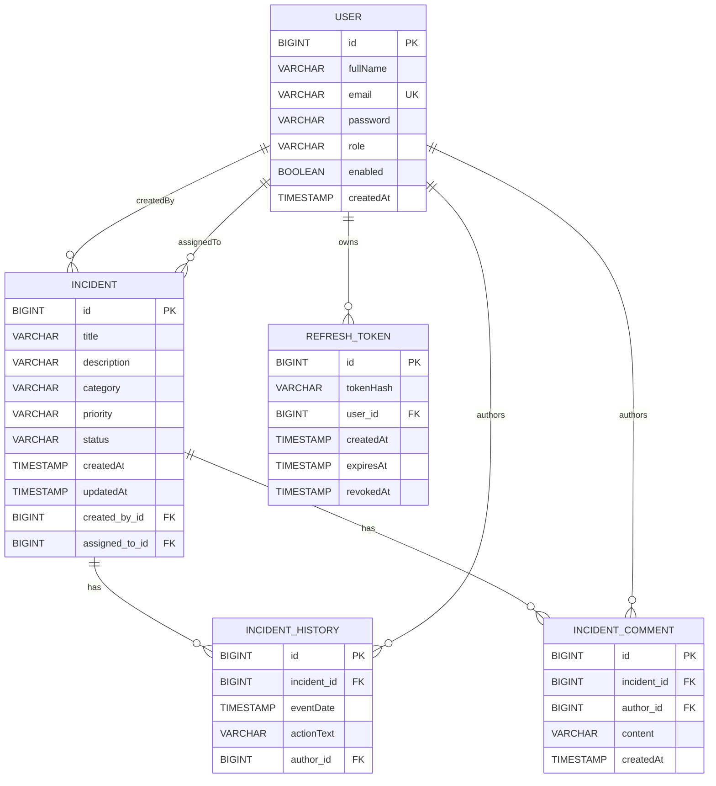
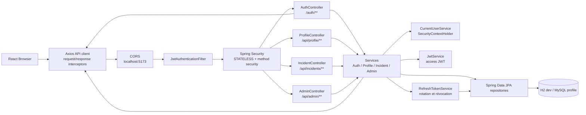
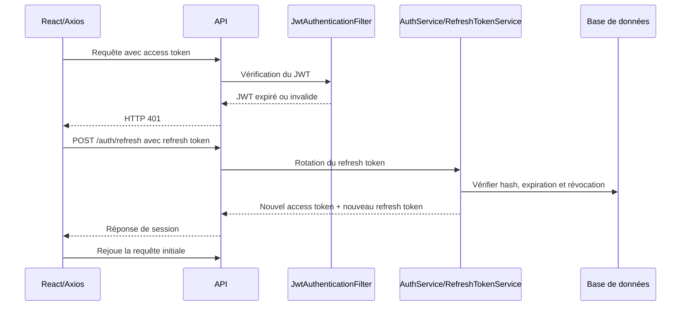

# Diagrammes du projet

Les diagrammes ci-dessous représentent uniquement les classes, relations et flux présents dans le code audité.

## 1. Diagramme des entités

Dans le code Java, ces liens sont portés par des `@ManyToOne(fetch = FetchType.LAZY)` depuis `Incident`, `IncidentHistory`, `IncidentComment` et `RefreshToken`. Les collections inverses `@OneToMany` ne sont pas déclarées.

## 2. Diagramme d’architecture et flux d’une requête

Le filtre valide le JWT présent dans `Authorization: Bearer ...`, recharge l’utilisateur par son email et place une authentification dans le `SecurityContext`. Les contrôleurs délèguent aux services. Les services appliquent les règles métier, puis utilisent les repositories pour accéder à la base. Les réponses sont des DTO JSON.

## 3. Flux de renouvellement d’une session

