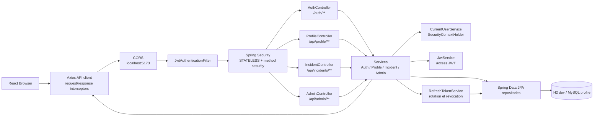
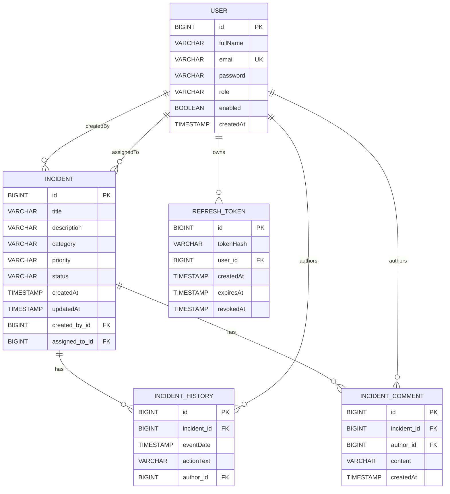
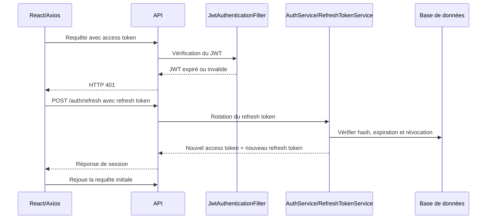

# Rapport de devoir

## Authentification et autorisation avec Spring Security, JWT et React

### Page de garde

| Élément | Information |
|---|---|
| Nom et prénom | **À compléter** |
| Filière | **À compléter** |
| Module | **À compléter** |
| Enseignant | **À compléter** |
| Date | **À compléter** |
| Projet | `incidents-api` et `incidents-front` |

---

## Sommaire

1. Introduction et objectifs  
2. Architecture et technologies  
3. Modèle de données  
4. Authentification et JWT  
5. Configuration Spring Security et rôles  
6. Contrôle du propriétaire et règles métier  
7. Validation et gestion des exceptions  
8. Frontend React  
9. Historique et scénario du §24  
10. Tests automatisés et captures  
11. Écarts et limites  
12. Conclusion  
13. Sources du projet  
14. Annexe A — Sortie du scénario Phase 4  

## 1. Introduction et objectifs

Nous avons réalisé une application de déclaration et de suivi d’incidents de sécurité. Elle associe une API Spring Boot à une interface React. L’accès à l’API est protégé par Spring Security et par des jetons JWT.

Nos objectifs sont les suivants :

- authentifier les utilisateurs et distinguer les rôles `EMPLOYEE`, `TECHNICIAN` et `ADMIN` ;
- permettre à un employé de déclarer et de suivre ses incidents ;
- permettre à un administrateur de consulter la file globale et d’affecter les incidents ;
- permettre au technicien affecté de faire progresser le traitement ;
- contrôler le propriétaire de chaque incident ;
- conserver un historique des changements et des notes de traitement ;
- vérifier les règles de sécurité avec des tests automatisés.

Nous avons fondé les descriptions et les résultats de ce rapport sur les classes, les configurations, les scripts et les tests du projet.

## 2. Architecture et technologies

### 2.1 Architecture en couches

Nous avons organisé le backend en plusieurs couches :

1. les contrôleurs exposent les routes HTTP ;
2. Spring Security filtre et authentifie la requête ;
3. les services appliquent les règles métier ;
4. les repositories Spring Data JPA accèdent aux entités ;
5. H2 est utilisé avec le profil de développement et MySQL est prévu avec le profil `mysql`.

Le frontend React appelle l’API avec Axios. Les diagrammes ci-dessous décrivent les entités, le flux de requête et le renouvellement de session.

### 2.2 Technologies utilisées

**Tableau 1 — Technologies du projet**

| Domaine | Technologie |
|---|---|
| Backend | Java 17, Spring Boot 3.5.6 |
| Sécurité | Spring Security, JJWT 0.12.6, BCrypt |
| Persistance | Spring Data JPA, H2 en développement, MySQL par profil |
| Validation | Jakarta Validation |
| Frontend | React 19.1.1, React Router 7.9.4, Vite 7.1.7 |
| Client HTTP | Axios 1.8.4 |

### 2.3 Diagramme d’architecture générale



Nous validons le JWT dans `JwtAuthenticationFilter`, puis nous déléguons la requête au contrôleur concerné. Les services appliquent les règles métier avant d’utiliser les repositories. Les contrôleurs renvoient des DTO JSON.

## 3. Modèle de données

### 3.1 Diagramme des entités



**Figure 1 — Modèle des entités et relations JPA.** Nous représentons ici les tables et les clés étrangères correspondant aux entités Java.

### 3.2 Utilisateur

L’entité `User` contient `id`, `fullName`, `email`, `password`, `role`, `enabled` et `createdAt`. L’adresse email est unique. Nous encodons le mot de passe avec `BCryptPasswordEncoder` avant l’enregistrement.

Les rôles présents dans le projet sont `EMPLOYEE`, `TECHNICIAN` et `ADMIN`. Lors d’une inscription publique, nous ignorons le champ `role` envoyé par le client et nous créons toujours un utilisateur `EMPLOYEE`.

### 3.3 Incident, historique et notes

L’entité `Incident` contient le titre, la description, la catégorie, la priorité, le statut, les dates de création et de mise à jour, le créateur et le technicien affecté.

`IncidentHistory` conserve l’incident, la date, l’action et l’auteur. Nous créons une entrée lors de la déclaration, de l’affectation et des changements d’état.

`IncidentComment` conserve une note, son auteur, l’incident et sa date de création. L’ajout d’une note est réservé au technicien affecté ou à l’administrateur.

### 3.4 Choix des relations `ManyToOne` et de `LAZY`

Nous avons choisi des relations unidirectionnelles `@ManyToOne(fetch = FetchType.LAZY)` depuis les objets dépendants vers leurs parents :

- `Incident.createdBy` et `Incident.assignedTo` vers `User` ;
- `IncidentHistory.incident` et `IncidentHistory.author` ;
- `IncidentComment.incident` et `IncidentComment.author` ;
- `RefreshToken.user`.

Nous n’avons pas ajouté de collections `@OneToMany(mappedBy = ...)` dans `User` ou `Incident`. Ce choix limite le chargement implicite de grandes collections et évite de parcourir automatiquement tout l’historique, toutes les notes ou tous les incidents d’un utilisateur. Nous récupérons les listes avec les repositories, par exemple `findByCreatedById...` ou `findByIncidentId...`.

Nous avons choisi `LAZY` plutôt que `EAGER` pour ne charger les relations que lorsque le service en a besoin. Les services concernés sont transactionnels et les contrôleurs renvoient des DTO, jamais les entités JPA. Cette combinaison limite les boucles JSON et les problèmes de chargement différé lors de la sérialisation. Aucun `EAGER` explicite n’est utilisé.

### 3.5 Statuts et choix de l’état `ASSIGNED`

Les statuts définis par l’application sont `OPEN`, `ASSIGNED`, `IN_PROGRESS`, `RESOLVED` et `CLOSED`. Nous utilisons `ASSIGNED` pour rendre visible l’étape d’affectation avant le traitement technique.

Le §24 du sujet résume le passage après l’affectation par `OPEN -> IN_PROGRESS`, alors que le §3.5 définit aussi le statut `ASSIGNED`. Nous avons retenu la séquence plus précise `OPEN -> ASSIGNED -> IN_PROGRESS`. Ce choix est cohérent avec l’existence du statut `ASSIGNED`, avec l’action d’affectation réservée à l’administrateur et avec la liste des incidents affectés du technicien.

## 4. Authentification et JWT

### 4.1 Inscription et connexion

Nous exposons les routes publiques suivantes :

- `POST /auth/register` ;
- `POST /auth/login` ;
- `POST /auth/refresh` ;
- `POST /auth/logout`.

Lors de l’inscription, nous validons le nom, l’email et le mot de passe, nous normalisons l’email, nous vérifions son unicité et nous encodons le mot de passe. Le rôle est forcé à `EMPLOYEE`.

Lors de la connexion, nous refusons les identifiants incorrects et les utilisateurs désactivés avec un message générique. En cas de succès, nous renvoyons un access token JWT, le rôle, le nom complet et un refresh token.

### 4.2 Claims et expiration

`JwtService` ajoute au JWT :

- l’email dans le sujet ;
- la date d’émission ;
- la date d’expiration ;
- le rôle dans le claim `role`.

Nous signons le JWT en HS256. Nous ne reproduisons ni la clé secrète ni un token complet dans ce rapport.

`JwtAuthenticationFilter` lit l’en-tête `Authorization`, vérifie le token, extrait l’email et recharge l’utilisateur. L’utilisateur doit encore exister et être activé. Nous reconstruisons l’autorité à partir du rôle en base et non à partir du claim `role` seul.

La vérification du JWT contrôle la signature et l’expiration. La durée de l’access token en développement est de **5 minutes (300000 ms)**.

### 4.3 Access token et refresh token

L’access token est le JWT court utilisé dans l’en-tête `Authorization`. Le refresh token sert à obtenir une nouvelle paire lorsque l’access token expire.

Le refresh token est bien implémenté. Nous stockons uniquement son hash avec ses dates de création, d’expiration et de révocation. L’appel à `/auth/refresh` effectue une rotation : l’ancien token est invalidé et une nouvelle paire est produite. `/auth/logout` révoque le refresh token fourni.

### 4.4 Flux de renouvellement



## 5. Configuration Spring Security et rôles

`SecurityConfig` configure CORS pour `http://localhost:5173`, désactive CSRF, impose une politique de session `STATELESS`, place le filtre JWT avant le filtre standard et fournit des réponses JSON pour les erreurs 401 et 403.

**Tableau 2 — Règles HTTP générales**

| Ressource | Règle configurée |
|---|---|
| `/auth/**` | publique |
| `/h2-console/**` | autorisée dans la configuration actuelle |
| OPTIONS | publique pour le CORS |
| `/api/**` | authentification obligatoire |
| autres routes | autorisées par la règle générale actuelle |

`@EnableMethodSecurity` active les annotations de sécurité placées sur les contrôleurs.

**Tableau 3 — Autorisations par rôle**

| Expression | Utilisation réelle |
|---|---|
| `hasRole('EMPLOYEE')` | créer un incident et consulter sa liste personnelle |
| `hasRole('TECHNICIAN')` | consulter les incidents affectés |
| `hasRole('ADMIN')` | administrer les utilisateurs, consulter la file globale et affecter |
| `hasAnyRole('TECHNICIAN', 'ADMIN')` | modifier un statut et ajouter une note |
| `isAuthenticated()` | consulter un détail, l’historique ou les commentaires |

Avec Spring Security, `hasRole('EMPLOYEE')` recherche habituellement l’autorité `ROLE_EMPLOYEE`. Nous construisons précisément les autorités sous la forme `ROLE_` suivie du rôle en base. `hasAuthority('...')` comparerait une autorité exacte sans ajouter automatiquement le préfixe ; cette expression n’est pas utilisée dans notre code.

## 6. Contrôle du propriétaire et règles métier

`CurrentUserService` récupère l’objet `Authentication` depuis `SecurityContextHolder`. Nous vérifions que l’authentification existe, qu’elle est active et qu’elle n’est pas anonyme. Le nom de l’authentification correspond à l’email placé dans le sujet du JWT, puis nous relisons l’utilisateur en base.

Pour lire un incident, nous autorisons :

- l’administrateur ;
- l’utilisateur qui a créé l’incident ;
- le technicien auquel l’incident est affecté.

Pour modifier le statut, nous vérifions qu’un technicien est réellement affecté à l’incident. L’administrateur peut affecter un technicien actif. Un incident `CLOSED` ne peut plus être modifié.

Les transitions implémentées sont :

- `OPEN -> IN_PROGRESS` pour l’administrateur ;
- `ASSIGNED -> IN_PROGRESS` ;
- `IN_PROGRESS -> RESOLVED` ;
- `RESOLVED -> CLOSED` ou `RESOLVED -> IN_PROGRESS` ;
- aucune transition depuis `CLOSED`.

Nous n’utilisons pas de paramètre `Principal` dans les contrôleurs. Nous avons choisi `Authentication` via `SecurityContextHolder`, puis une recherche de l’utilisateur en base.

## 7. Validation et gestion des exceptions

### 7.1 Validation

Nous utilisons les annotations Jakarta Validation suivantes :

- `@NotBlank` pour les champs textuels obligatoires ;
- `@Email` pour le format des adresses ;
- `@Size` pour limiter les longueurs ;
- `@NotNull` pour les catégories et priorités obligatoires ;
- `@Valid` sur les corps de requête des contrôleurs.

Une erreur de validation produit une réponse HTTP 400 avec un message général et une liste des champs invalides.

### 7.2 Gestion centralisée

Nous utilisons `@RestControllerAdvice`, spécialisation adaptée aux réponses JSON de `@ControllerAdvice`. `GlobalExceptionHandler` traite les `ApiException`, les erreurs de validation, les corps JSON illisibles, les conflits d’intégrité, les accès refusés et les erreurs imprévues.

Les réponses utilisent la structure `ErrorResponse` composée de `status`, `message` et, si nécessaire, `errors`.

**Tableau 4 — Signification des codes HTTP**

| Code | Cas traité dans le projet |
|---|---|
| 400 | données invalides, JSON illisible, transition interdite ou incident clôturé |
| 401 | JWT absent, invalide ou expiré, identifiants incorrects ou utilisateur désactivé |
| 403 | utilisateur authentifié sans droit ou technicien non affecté |
| 404 | incident, utilisateur ou technicien introuvable |
| 409 | email déjà utilisé ou conflit d’intégrité |

Nous produisons les erreurs de sécurité 401 et 403 avec `RestAuthenticationEntryPoint` et `RestAccessDeniedHandler`. Les exceptions métier `UnauthorizedException`, `ForbiddenException`, `BadRequestException` et `NotFoundException` passent par `GlobalExceptionHandler` via `ApiException`.

## 8. Frontend React

### 8.1 Routes protégées

`ProtectedRoute` redirige vers `/login` lorsqu’aucun JWT n’est présent. `RoleRoute` compare le rôle de session et redirige vers `/access-denied` si le rôle ne correspond pas.

Les routes déclarées sont notamment :

- `/dashboard` et `/profile` pour tout utilisateur connecté ;
- `/incidents/my` et `/incidents/new` pour `EMPLOYEE` ;
- `/incidents/assigned` pour `TECHNICIAN` ;
- `/admin/users` et `/admin/incidents` pour `ADMIN` ;
- `/incidents/:id` pour le détail d’un incident.

La protection frontend améliore l’expérience utilisateur, mais la décision de sécurité reste celle du backend.

### 8.2 Intercepteurs Axios

L’intercepteur de requête lit l’access token dans `localStorage` et ajoute `Authorization: Bearer ...`.

L’intercepteur de réponse intercepte un 401 sur une route non liée à l’authentification, appelle `/auth/refresh`, sauvegarde la nouvelle session puis rejoue la requête initiale. `refreshPromise` évite plusieurs renouvellements concurrents. Si le renouvellement échoue, nous supprimons la session et redirigeons l’utilisateur vers `/login`.

Les tokens et les informations d’affichage sont conservés dans `localStorage` sous les clés `jwt`, `refreshToken`, `role` et `fullName`.

### 8.3 Dashboards, historique et notes

Le dashboard adapte ses données au rôle :

- l’employé voit ses incidents et leurs compteurs ;
- le technicien voit les incidents affectés ;
- l’administrateur voit les statistiques et la file globale.

La page de détail charge l’incident, son historique et ses notes. Elle permet à l’administrateur d’affecter un technicien et aux rôles autorisés d’ajouter une note ou de demander un changement d’état. Le backend reste l’autorité finale.

## 9. Historique et scénario du §24

Nous avons exécuté `scripts/phase4-scenario.ps1`. Le scénario vérifie 17 étapes : création de deux employés, vérification d’un technicien actif, connexions, déclaration de trois incidents, isolation entre employés, consultation administrateur, affectation, consultation technicien, transitions, ajout d’une note et consultation finale.

**Tableau 5 — Correspondance des étapes du §24**

| Étapes | Action réalisée | Résultat observé |
|---|---|---|
| 1–2 | créer deux comptes employés | comptes créés |
| 3 | vérifier les comptes de développement et un technicien actif | technicien disponible |
| 4 | connecter le premier employé | connexion réussie |
| 5 | déclarer deux incidents | deux incidents créés |
| 6–7 | connecter le second employé et déclarer son incident | incident créé par un second propriétaire |
| 8 | tester l’isolation entre employés | accès refusé |
| 9–10 | connecter l’administrateur et consulter la file globale | incident visible pour ADMIN |
| 11 | affecter le premier incident | statut `ASSIGNED` |
| 12–13 | connecter le technicien et consulter ses affectations | incident visible dans sa file |
| 14 | faire progresser le statut | `ASSIGNED -> IN_PROGRESS -> RESOLVED` |
| 15 | ajouter une note | note enregistrée |
| 16–17 | reconnecter l’employé et consulter le résultat | état, historique et note vérifiés |

Nous avons donc retenu `ASSIGNED` comme étape intermédiaire, en cohérence avec les statuts du §3.5 du sujet. La formulation abrégée du §24 peut être lue comme une présentation simplifiée du traitement après affectation.

## 10. Tests automatisés et captures

### 10.1 Résultat Maven

Nous avons exécuté la commande suivante depuis `incidents-api` :

```text
.\mvnw.cmd test
```

Le résultat est : `Tests run: 15, Failures: 0, Errors: 0, Skipped: 0 — BUILD SUCCESS`.

### 10.2 Tests obligatoires du §25

**Tableau 6 — Tests obligatoires et résultats**

| §25 | Test automatisé | Résultat |
|---|---|---|
| 1. Route protégée sans JWT | `protectedRouteWithoutJwtReturns401` | PASS — 401 |
| 2. JWT invalide | `invalidJwtReturns401` | PASS — 401 |
| 3. JWT expiré | `expiredJwtReturns401` | PASS — 401 |
| 4. EMPLOYEE sur route ADMIN | `employeeCannotAccessAdminRoute` | PASS — 403 |
| 5. Incident d’un autre employé | `employeeCannotReadAnotherEmployeesIncident` | PASS — 403 |
| 6. TECHNICIAN non affecté | `technicianCannotModifyUnassignedIncident` | PASS — 403 |
| 7. Utilisateur désactivé | `disabledUserCannotLoginOrUseExistingToken` | PASS — 401 |
| 8. Email dupliqué | `duplicateEmailReturns409` | PASS — 409 |
| 9. Incident invalide | `invalidIncidentReturns400WithFieldErrors` | PASS — 400 |

**Tableau 7 — Tests complémentaires**

| Test automatisé | Résultat |
|---|---|
| `closedIncidentCannotChangeStatus` | PASS |
| `validStatusTransitionsAndReopeningAreAccepted` | PASS |
| `registrationAlwaysCreatesEmployeeEvenWhenAdminIsSent` | PASS |
| `refreshRotatesTheRefreshTokenAndReturnsANewAccessToken` | PASS |
| `logoutRevokesTheRefreshToken` | PASS |
| `disabledUserCannotRefreshAnExistingRefreshToken` | PASS |

### 10.3 Captures Postman


**Figure 2 — Connexion réussie d’un employé dans Postman.** Nous voyons la requête `POST /auth/login`, la réponse `200 OK`, le rôle `EMPLOYEE`, le nom `Employé Un` et les champs de session. Les valeurs des tokens sont masquées dans la copie utilisée par le rapport.


**Figure 3 — Création réussie d’un incident par l’employé.** Nous voyons la requête `POST /api/incidents` avec le titre « Tentative de phishing détectée », la catégorie `PHISHING`, la priorité `HIGH` et la réponse `200 OK`. La réponse indique le statut `OPEN` et le créateur `Employé Un`.


**Figure 4 — Consultation de la liste personnelle de l’employé.** Nous voyons la requête `GET /api/incidents/my`, l’utilisation du Bearer Token sous forme de variable Postman `{{employeeToken}}`, la réponse `200 OK` et l’incident de phishing dans la liste.

Pour l’étape de déclaration du second employé, nous utilisons la vérification automatisée du scénario Phase 4, reproduite dans l’annexe A. Aucun token n’est affiché dans cette sortie et aucun secret n’y apparaît.

## 11. Écarts et limites

### 11.1 Choix de modélisation JPA

Nous avons choisi des relations unidirectionnelles `ManyToOne` en `LAZY` et l’utilisation de DTO. Les collections inverses `OneToMany` ne sont pas déclarées. Ce choix est adapté aux consultations ciblées et limite les chargements implicites, mais il ne présente pas un modèle bidirectionnel complet.

### 11.2 Transition d’état

Nous utilisons `ASSIGNED` entre `OPEN` et `IN_PROGRESS`, car ce statut est défini au §3.5 et correspond à l’action d’affectation. Le §24 résume toutefois la séquence par `OPEN -> IN_PROGRESS`. Nous conservons cette différence comme un choix explicite de modélisation et non comme une transition cachée.

### 11.3 Console H2

La route `/h2-console/**` est autorisée dans `SecurityConfig` sans condition explicite liée au profil actif. La configuration MySQL désactive H2, mais nous devrions limiter encore cette autorisation au développement ou la supprimer en production.

### 11.4 Configuration CORS

La propriété `app.cors.allowed-origin` existe, mais l’origine est écrite directement dans `SecurityConfig`. Nous devrions utiliser effectivement la propriété afin d’éviter une configuration dupliquée.

### 11.5 Stockage des tokens

Le frontend stocke l’access token et le refresh token dans `localStorage`. Une faille XSS pourrait les exposer. Nous pourrions placer le refresh token dans un cookie `HttpOnly`, `Secure` et `SameSite` adapté, avec une stratégie CSRF cohérente.

### 11.6 CSRF et production

Nous désactivons CSRF parce que l’API utilise une session stateless et un en-tête Bearer. Ce choix doit être réévalué si nous passons à une authentification par cookies. La clé JWT de développement doit également être remplacée par une clé externe, longue et renouvelée, avec HTTPS.

## 12. Conclusion

Nous avons mis en œuvre une authentification JWT stateless, une séparation des rôles et un contrôle métier du propriétaire et du technicien affecté. Les validations, les réponses d’erreur, l’historique et les notes sont intégrés dans l’API. Le frontend protège les routes, adapte les dashboards aux rôles et renouvelle automatiquement la session avec un refresh token tournant.

La commande Maven a réussi avec 15 tests sur 15. Les neuf contrôles obligatoires du §25 sont couverts par des tests automatisés. Le scénario Phase 4 a également réussi ses 17 étapes et a vérifié l’état final, l’historique et la note de traitement.

## 13. Sources du projet

Nous avons utilisé les sources suivantes :

- sujet `devoir_jwt_spring_security_react.pdf` ;
- classes backend sous `incidents-api/src/main/java/ma/formation/incidentsapi/` ;
- configurations sous `incidents-api/src/main/resources/` ;
- tests sous `incidents-api/src/test/java/ma/formation/incidentsapi/SecurityIntegrationTest.java` ;
- composants frontend sous `incidents-front/src/` ;
- scripts `scripts/phase4-scenario.ps1` et `scripts/phase7-automated-verification.ps1`.

## 14. Annexe A — Sortie réelle du scénario Phase 4

Nous avons exécuté `scripts/phase4-scenario.ps1` avec le backend démarré. Le script n’affiche aucun access token ni refresh token. Aucun secret n’a donc été affiché ; si un token était produit dans une sortie destinée au rapport, nous le limiterions à 20 caractères suivis de `...`.

```text
[01/17] Création du premier compte EMPLOYEE
[02/17] Création du deuxième compte EMPLOYEE
[03/17] Vérification des comptes TECHNICIAN et ADMIN de développement
[04/17] Connexion du premier employé
[05/17] Déclaration de deux incidents par le premier employé
[06/17] Connexion du deuxième employé
[07/17] Déclaration d’un incident par le deuxième employé
[08/17] Vérification de l’isolation entre employés
[09/17] Connexion de l’administrateur
[10/17] Consultation de tous les incidents par ADMIN
[11/17] Affectation du premier incident au technicien
[12/17] Connexion du technicien
[13/17] Consultation des incidents affectés par TECHNICIAN
[14/17] Transitions ASSIGNED -> IN_PROGRESS -> RESOLVED
[15/17] Ajout d’une note de traitement
[16/17] Reconnexion du premier employé
[17/17] Vérification de l’état final, de l’historique et de la note

SCÉNARIO PHASE 4 RÉUSSI
Incident vérifié: #8 | état final: RESOLVED | événements: 4 | notes: 1
Comptes temporaires créés: scenario.employee1.20261030010017@example.com, scenario.employee2.20261030010017@example.com
```
